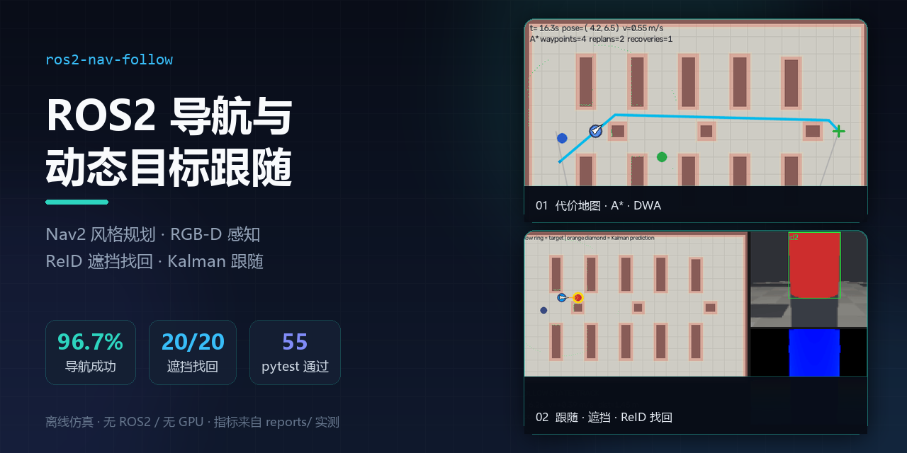
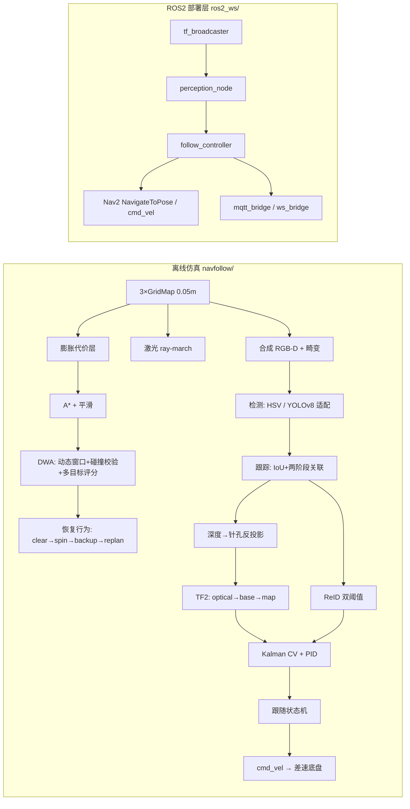

# ros2-nav-follow



> **一句话定位**：用纯 Python 把 ROS2 Nav2 那条链路按 1:1 拆开重写——地图 → 代价地图膨胀 → A* → DWA → 恢复行为；
> 再接一段「YOLO 风格检测 + 多目标跟踪 + ReID + RGB-D 反投影 + TF2 → PID/Kalman 跟随」，
> 在没有 ROS2、没有 GPU 的机器上跑出可复现的量化评测和 demo。另附一套完整的 ROS2 Jazzy ament 包，
> 供 Ubuntu + Gazebo 或树莓派 5 真机部署。

个人项目 · 2026.03–2026.06 ｜ 关键词：ROS2 Jazzy · Nav2 · SLAM Toolbox · TF2 · YOLOv8 · ByteTrack · ReID · RGB-D · PID · Kalman · 树莓派 5

---

## 1. 一句话定位：它解决什么问题

"会 ROS2、会导航"放在嘴上很容易，落到代码里就是一堆没跑过的概念。这个仓库把导航和跟随两端都拆成
**能跑、能测、能被追问**的东西：

- 导航：3 张 2D 地图（货架、窄走廊、立柱）、A* 全局规划、DWA 动态窗口局部规划、代价地图膨胀；
  stall 检测 + Nav2 风格恢复行为（清代价地图 → 旋转 → 后退 → 松膨胀重规划）；
- 感知：检测器接口（离线 HSV / 可选 YOLOv8n 适配器）、IoU + 匈牙利匹配的两阶段跟踪、
  颜色直方图 ReID、深度中值 + 针孔反投影、显式时间戳同步与 TF 查询；
- 跟随：Kalman 恒速模型预测 + PID 距离/方位双环 + 目标速度前馈，6 状态机
  （SEARCH/TRACK/OCCLUDED/REACQUIRE/ARRIVED/STOP）、ReID 双阈值重捕获、安全距离停车；
- 评测：30 次导航 trial + 20 次 1–3s 遮挡事件，指标全部实测并落盘到 `reports/`；
- 部署：ROS2 ament 包、Nav2 参数（costmap/DWB/recovery/行为树注释）、URDF、Gazebo 世界、rviz、
  MQTT/WebSocket 遥测、树莓派 5 部署与标定文档。

## 2. 效果与实测指标

数字都在 `reports/` 里，来自离线仿真的实际运行：30 个导航 trial + 20 次遮挡，跑满一次 245s。
没有挑数据——唯一失败的那个 trial、两个需要恢复行为的 trial，都原样留在报告里。

| 类别 | 指标 | 实测 |
| --- | --- | --- |
| 导航（30 trials = 3 地图 × 10） | 成功率 | **96.7%（29/30）** |
|  | 碰撞次数 | **0** |
|  | 路径长度比（成功；均值 / 中位数） | **1.05 / 0.96** |
|  | 平均耗时 | 26.1 s |
|  | 需要恢复行为的 trial | 2/30（共 7 次恢复动作） |
| 遮挡重识别（20 事件，遮挡 1.0–2.7s） | 找回率 | **100%（20/20，身份全部正确）** |
|  | 恢复耗时（重现 → TRACK） | mean **0.10 s** / p95 0.10 s |
| 跟随 | 距离误差（稳态 TRACK） | mean **0.057 m** / p95 **0.283 m** |
|  | TRACK 占比 / 跟随期碰撞 | 88.6% / 0 |
| 工程 | pytest | **55 passed**（约 32s） |
|  | Demo | 3 段 GIF，2.04 / 2.75 / 2.79 MB；另有 H.264 MP4 |

按地图拆开看导航：

| 地图 | 规格 | 成功率 | 碰撞 | 平均耗时 | 路径比（成功均值） |
| --- | --- | --- | --- | --- | --- |
| warehouse_a | 20×13m，10 组货架 + 3 立柱 | 10/10 | 0 | 28.0 s | 1.25* |
| warehouse_b | 18×12m，迷宫式货架 + 死胡同 | 9/10 | 0 | 26.2 s | 0.96 |
| corridor_c | 16×11m，1.6m 窄走廊 + 1.2m 门洞 | 10/10 | 0 | 24.1 s | 0.94 |

\* 均值被一次"3 次恢复后绕行成功"的 trial（路径比 3.79）拉高；中位数 0.96。

### Demo（真实仿真运行录制）

| 文件 | 内容 | 视频 |
| --- | --- | --- |
| `demos/01_nav_path.gif` | 代价地图膨胀 + A* 全局路径 + DWA 局部控制 + 动态行人 | [MP4](demos/01_nav_path.mp4) |
| `demos/02_follow_occlusion.gif` | 跟随 → 遮挡（Kalman 外推）→ ReID 重捕获；左侧俯视 + 右上相机检测框 + 右下深度图 | [MP4](demos/02_follow_occlusion.mp4) |
| `demos/03_recovery.gif` | 路径前方突然出现障碍 → stall → 恢复行为（旋转/后退）→ 松膨胀重规划 → 到达 | [MP4](demos/03_recovery.mp4) |

MP4 是同一批帧转的 H.264（yuv420p，8–10fps），体积 0.10 / 0.23 / 0.15 MB，GIF 加载慢的话看这个。

## 3. 系统架构



模块划分、坐标链、状态机图都在 `docs/architecture.md`。两个设计取舍值得先说：

- 仿真和 ROS2 层共用同一套算法拆分和同一组参数（PID/DWA 权重/状态机阈值），仿真里调好的值按参数表映射到机器人，不重新推；
- 碰撞层、DWA 安全距离层、A* 规划层在 `maps.py` 里是分开的三层，碰撞判定和规划膨胀互不干扰。

## 4. 快速开始

### 4.1 离线仿真（Windows / macOS / Linux 都能跑）

```bash
git clone https://github.com/cyanxi-eb/ros2-nav-follow.git && cd ros2-nav-follow
python3.12 -m venv .venv                       # Python 3.12
# Windows: .venv\Scripts\activate      Linux/macOS: source .venv/bin/activate
pip install -r requirements.txt

# 55 个测试（约 32s）
python -m pytest -q

# 快速评测（CI 模式，约 50s）：3 地图 × 2 trials + 2 episode × 2 遮挡
python -m navfollow.evaluate --quick --no-demos

# 全量评测（约 4–5 分钟）：30 trials + 20 遮挡事件，写 reports/
python -m navfollow.evaluate --no-demos

# 生成 3 段 demo GIF（约 70s）
python -m navfollow.demo
```

评测和 demo 脚本都是纯 Python（numpy + OpenCV + Pillow），不需要 ROS2、Gazebo、GPU。

### 4.2 Linux + ROS2 Jazzy + Gazebo Harmonic

```bash
# 依赖、world 文件、编译、启动步骤见 docs/ros2_integration.md
cd ~/ros2_ws && colcon build --symlink-install --packages-select follow_robot
source install/setup.bash
ros2 launch follow_robot sim.launch.py use_slam:=true
```

### 4.3 真机（树莓派 5 + RPLIDAR A1 + 深度相机）

BOM、接线、systemd、安全边界、验收清单见 `docs/real_robot.md`；相机-底盘标定与时间同步见
`docs/calibration.md`。启动入口：

```bash
ros2 launch follow_robot follow.launch.py map:=$HOME/maps/warehouse_a.yaml
```

> **注意**：ROS2 / Gazebo / 真机链路**没有在装了 ROS2 的机器上跑过**。`ros2_ws/` 只过了
> `python -m compileall -q ros2_ws` 语法检查和人工 review，第一次上机要按
> `docs/ros2_integration.md` 第 8 节逐条验证。Gazebo 世界文件已随仓库提供：`worlds/warehouse.world`，
> 内容是标准 SDF 1.9 XML（用 `.world` 扩展名，Gazebo 按内容解析，扩展名不影响加载）。
> 离线 `maps/` 下 3 张 PGM/YAML 也已生成。

## 5. 话题与服务表

### ROS2 节点（`ros2_ws/src/follow_robot`）

| 节点 | 订阅 | 发布 / 动作 |
| --- | --- | --- |
| `perception_node` | `/camera/color/image_raw` (Image)<br/>`/camera/depth/image_raw` (Image)<br/>`/camera/color/camera_info` (CameraInfo)<br/>`/follow/select_target` (Bool) | `/follow/target_pose` (PoseStamped, base_link)<br/>`/follow/target_world` (PointStamped, map)<br/>`/follow/target_visible` (Bool)<br/>`/follow/target_track_id` (Int32)<br/>`/follow/reid_feature` (Float32MultiArray)<br/>`/follow/candidates` (String JSON)<br/>`/follow/debug_image` (Image)<br/>`/follow/status` (String JSON) |
| `follow_controller` | `/follow/target_world`、`/follow/candidates`、`/follow/target_visible`、`/follow/target_track_id`、`/odom` | `/cmd_vel` (Twist)<br/>`/follow/state` (String)<br/>`/follow/status` (String JSON)<br/>action client `/navigate_to_pose`（SEARCH 兜底） |
| `tf_broadcaster` | `/odom` | `/tf`（odom→base_link）<br/>`/tf_static`（base_link→camera_link→camera_optical、base_link→laser） |
| `mqtt_bridge` | `/follow/status` | MQTT `follow_robot/state`、`follow_robot/online`（retained） |
| `ws_bridge` | `/follow/status` | WebSocket `ws://<host>:8765`，5 Hz 推同一份 JSON |

`/follow/candidates` 载荷示例：

```json
{"stamp": 12.34,
 "candidates": [
   {"track_id": 7, "distance": 1.42, "bearing": -0.05,
    "world": [8.31, 6.48], "similarity": 0.93, "score": 0.96, "area": 8421}
 ]}
```

`/follow/status` 载荷示例（控制节点侧）：

```json
{"state": "TRACK", "v": 0.42, "w": 0.03, "distance": 1.44, "bearing": 0.01,
 "target_visible": true, "target_track_id": 7, "candidates": 1,
 "reacquire_attempts": 1, "reacquire_success": 1, "pose": [8.1, 6.5, 0.02]}
```

### 离线仿真 CLI

| 命令 | 作用 |
| --- | --- |
| `python -m navfollow.evaluate --quick` / `--no-demos` / `--nav-trials N` / `--occlusion-episodes N` | 评测，写 `reports/eval_YYYYMMDD.{json,md}` |
| `python -m navfollow.demo` | 生成 `demos/*.gif` |
| `python tools/export_maps.py` | 把离线地图导出成 ROS `map_server` 的 PGM+YAML |

## 6. 评测方法与结果

完整协议、指标定义、seed、耗时和限制见 `docs/evaluation.md`，结论摘要就是第 2 节。几个要点：

- 导航 success：到达 0.35m 内**且全程无碰撞**；路径长度比以首次 A* 路径为基准；
- 遮挡重识别：目标重现后 5s 内回到 TRACK，且观测世界坐标与真值误差 <0.9m 才算成功；
- 距离误差：TRACK 稳态，排除每次进入 TRACK 后 2.0s 的收敛窗口（这段瞬态用"恢复耗时"单独衡量）；
- 报告文件是 `reports/eval_20261020.md`，里面的数字和本文一致。

复跑：

```bash
python -m navfollow.evaluate --no-demos      # 约 4–5 分钟，确定性
```

## 7. 失败案例（真实遇到，详见 `docs/failure_cases.md`）

1. **DWA 原地打转**：局部切线误用全局终点，越过前视点后目标翻到身后 → 改弧长投影 + 前视点；
2. **相机全黑/距离≈0**：漏了 REP-103 光学坐标系旋转 + pitch 符号反了 → 拆分 body/optical 旋转；
3. **跟踪器永远无轨迹**：ByteTrack 两阶段关联覆盖了未匹配检测 → 保留高分未匹配结果；
4. **路径被堵却不触发恢复**：stall 判据含旋转，原地打转不算 stall → 改沿路径弧长进度判据；
5. **ReID 首次捕获失败**：运动门控在 Kalman 未初始化时恒 false → 无预测时按观测有效性放行；
6. **时间戳不同步**：RGB/深度差 0.08s（>50ms 容差）时整帧被丢、跟随失效 → 显式同步/丢帧 + 标定文档。

## 8. 限制与下一步

**限制**

- ROS2 / Gazebo / 真机链路没在装了 ROS2 的机器上跑过，所有 ROS2 数字与行为都等上机验证；
- 自动化评测用的是合成相机 + HSV 颜色检测器，**YOLOv8n 适配器不参与评测**（没有 GPU，不装 torch）；
- DWA/A* 是 Nav2 的简化替身，没复现 Nav2 的 behavior tree、costmap 插件组合和 AMCL 定位误差；
- 遮挡最长 2.7s（< `occluded_timeout` 3.2s）；超过 3.2s 的长遮挡、多人密集交叉、光照变化都没测；
- Gazebo 世界文件 `worlds/warehouse.world` 已提供（SDF 内容、`.world` 扩展名），但**没在 Gazebo 里加载验证过**，
  模型按离线 `warehouse_a` 地图坐标 1:1 摆放。

**下一步（按优先级）**

1. Ubuntu 24.04 + Jazzy + Gazebo 上跑通 `sim.launch.py`，把 Gazebo 评测结果补进报告；
2. 树莓派 5 真机：完成相机-底盘标定、时间同步、系统服务，再跑 10 条现场场景；
3. 检测/ReID 升级：YOLOv8n（或 YOLO11n）+ OSNet 外观特征，替掉 HSV / 颜色直方图；
4. 长时间遮挡：多假设跟踪（多分支 Kalman）+ 主动搜索（Nav2 目标点搜索），把找回率做成遮挡时长的曲线；
5. 接上层任务编排：把"跟随 / 停止 / 去某处"封装成带前置后置条件的技能。

## 9. 目录结构

```
ros2-nav-follow/
├── navfollow/                     # 纯 Python 离线仿真（核心）
│   ├── geometry.py / tf_tree.py   # 几何、四元数、最小 TF 树（含时间戳插值）
│   ├── maps.py                    # 3 张地图 + 膨胀层/可通行层
│   ├── planning.py / dwa.py       # A* + 路径平滑 / DWA 局部规划
│   ├── navstack.py                # Nav2 风格导航栈 + 恢复行为
│   ├── camera.py                  # 合成 RGB-D 相机（针孔+畸变+LoS 遮挡）
│   ├── world.py / persons.py      # 世界、激光、脚本行人（含遮挡）
│   ├── perception/                # 检测器/跟踪/ReID/投影/TF 管线
│   ├── follow/                    # Kalman、PID、跟随状态机
│   ├── simulation.py              # 导航 trial / 跟随 episode
│   ├── evaluate.py                # 30 trials + 20 遮挡的事件评测与报告
│   ├── render.py / demo.py        # 俯视/相机渲染、GIF 合成
│   └── ...
├── tests/                         # 55 个 pytest（几何/TF、规划、感知、跟随、仿真）
├── ros2_ws/src/follow_robot/      # ROS2 Jazzy ament 包（未在 ROS2 环境运行）
│   ├── follow_robot/              # perception_node / follow_controller / tf_broadcaster
│   │                              # mqtt_bridge / ws_bridge / *_core 算法模块
│   ├── launch/                    # sim.launch.py、follow.launch.py、robot_state.launch.py
│   ├── config/                    # nav2_params.yaml（含注释）、follow.yaml
│   ├── urdf/ worlds/ rviz/ maps/  # 机器人模型、Gazebo 世界 warehouse.world、rviz、PGM 地图
│   └── package.xml / setup.py
├── docs/                          # 架构 / 评测 / 失败案例 / 标定 / 真机 / ROS2 集成
├── demos/                         # 3 段真实仿真 GIF + H.264 MP4
├── assets/cover.png               # 本页封面（取自 demo 关键帧）
├── reports/                       # eval_YYYYMMDD.json/.md（实测）
├── tools/export_maps.py           # 导出 map_server 地图
├── .github/workflows/ci.yml       # Ubuntu + Python 3.12：pytest + quick eval
├── requirements.txt / pytest.ini / LICENSE / .gitignore
```

## 10. 版本与许可

- 版本：**v1.0.0**（个人项目，2026.03–2026.06 做了主体；离线仿真与文档 2026-10 收尾）
- 评测环境：离线工作站，纯 Python 仿真（无 ROS2 / 无 GPU）
- 许可：[MIT](LICENSE) © 2026 cyanxi-eb
