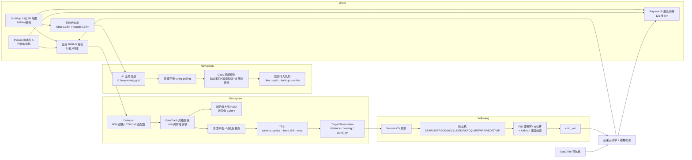

# 架构说明

项目分两层：**离线可复现仿真链路**（本仓库 `navfollow/`，纯 Python，本机可直接跑）
与 **ROS2 部署层**（`ros2_ws/src/follow_robot/`，rclpy + Nav2 + Gazebo），两层共用同一套
算法模块拆分、同一组参数（PID/DWA 权重/状态机阈值），因此仿真里调好的行为可以按参数映射到机器人。

## 1. 离线仿真链路（核心）



关键设计点：

| 模块 | 文件 | 说明 |
| --- | --- | --- |
| 几何 / TF | `navfollow/geometry.py`、`navfollow/tf_tree.py` | 四元数/旋转矩阵、TF 树（静态+动态+时间戳插值）、`base_link`↔`camera_optical` |
| 地图与代价层 | `navfollow/maps.py` | 3 张地图；`robot_blocked`（碰撞层）、`blocked_margin`（DWA 安全距离层）、`plan_free`（A* 层） |
| 全局规划 | `navfollow/planning.py` | A*（8 邻接、代价膨胀、heuristic 校正）、路径平滑、弧长投影/取点 |
| 局部规划 | `navfollow/dwa.py` | 动态窗口采样、前向仿真、碰撞/动态障碍校验、6 项评分（与 `nav2_params.yaml` 的 DWB critics 对应） |
| 恢复行为 | `navfollow/navstack.py` | 进度式 stall 检测 → clear costmap → spin → backup → relaxed replan；事件全部记录 |
| 合成相机 | `navfollow/camera.py` | 2.5D 渲染（地面逐像素 ray-cast + 行人圆柱 + z-buffer + 2D LoS 遮挡）、镜头畸变、深度图 |
| 感知 | `navfollow/perception/` | 检测器接口、跟踪器、ReID、深度反投影、TF 链路、目标观测输出 |
| 跟随 | `navfollow/follow/` | Kalman CV、PID、状态机、ReID 双阈值重关联 |
| 评测 | `navfollow/simulation.py`、`navfollow/evaluate.py` | 30 导航 trials、20 遮挡事件、报告生成 |
| Demo | `navfollow/demo.py`、`navfollow/render.py` | 真实仿真回放出 3 段 GIF |

## 2. 坐标链（面试重点）

```
map ──(AMCL / 仿真真值)──> odom ──(轮式里程计/仿真)──> base_link
                                                         │ 外参标定 (x=0.12, z=1.05, pitch=8°)
                                                         ▼
                                                    camera_link ──(REP-103)──> camera_optical
```

像素 → 底盘链路（`navfollow/perception/projection.py`）：

1. 去畸变（OpenCV 径向-切向模型，K/D 来自 `CameraInfo`）；
2. bbox 中心区域取有效深度中值（抗腿间空洞）；
3. 针孔反投影：`x=(u-cx)z/fx, y=(v-cy)z/fy, z=d` → optical 3D 点；
4. `T_base_optical = TF.lookup(base_link, camera_optical, stamp)`；
5. `distance = ||(x_fwd, y_left)||`，`bearing = atan2(y_left, x_fwd)`；
6. 再用 `map<-base_link` 得到世界坐标，喂给 Kalman。

时间戳策略：RGB 与深度帧时间差 > `sync_slop` 直接丢帧（`depth_rgb_timestamp_mismatch`）；
TF 查询使用图像时间戳，超出 buffer 容差抛 `ExtrapolationError` → 丢帧
（`tf_unavailable`），而不是静默使用错误位姿。

## 3. 跟随状态机

```
SEARCH ──目标可见──> TRACK ──丢失>0.35s──> OCCLUDED ──外推>3.2s──> REACQUIRE
   ▲                   │                        │  ReID 强匹配/连续弱匹配        │
   │                   │                        └──────────────> TRACK <────────┘
   │                   └──目标静止 3s──> ARRIVED                  超时 6s → STOP
   └── 搜索超时 12s ──────────────────────────────────────────────────────────> STOP
```

- **TRACK**：用 Kalman 外推 0.18s 做延迟补偿；PID 输出叠加目标速度前馈（消除常速行走的稳态误差）；
  深度相机量到的是人体前表面，加 0.22m 体内偏移后再和目标距离 1.40m 比较。
- **OCCLUDED**：Kalman 继续外推，机器人按预测位置减速跟随；有安全前向探测，前方被挡则停车等待。
- **REACQUIRE**：ReID 相似度 + 运动门控双阈值（强匹配阈值 0.78 直接接受，弱匹配 0.52 需连续 3 帧），
  同时旋转扫描并限时；超时进入 STOP 停车。
- **ARRIVED**：目标速度 < 0.14m/s 且持续 3s → 停车（用于“把客人送到工位后停下”场景）。

## 4. ROS2 部署层

```
/camera/color/image_raw ─┐
/camera/depth/image_raw ─┼─> perception_node ─> /follow/target_pose (base_link)
/camera/color/camera_info┘        │             /follow/target_world  (map)
                                  │             /follow/candidates (JSON: ReID + 运动门控输入)
                                  ▼
                        follow_controller ─> /cmd_vel
                                  │          └> Nav2 NavigateToPose（搜索阶段）
                                  ├> /follow/status (JSON) ─> mqtt_bridge / ws_bridge
                                  └> /follow/state (String)
```

节点清单与话题/服务表见 `README.md` 第 5 节；启动步骤见 `docs/ros2_integration.md`。
**重要：ROS2 层未在开发机运行过**（本机 Windows，无 ROS2/Gazebo），代码通过 `py_compile`
语法检查与人工 review；首次上机必须按文档在人监督下逐项验证。
